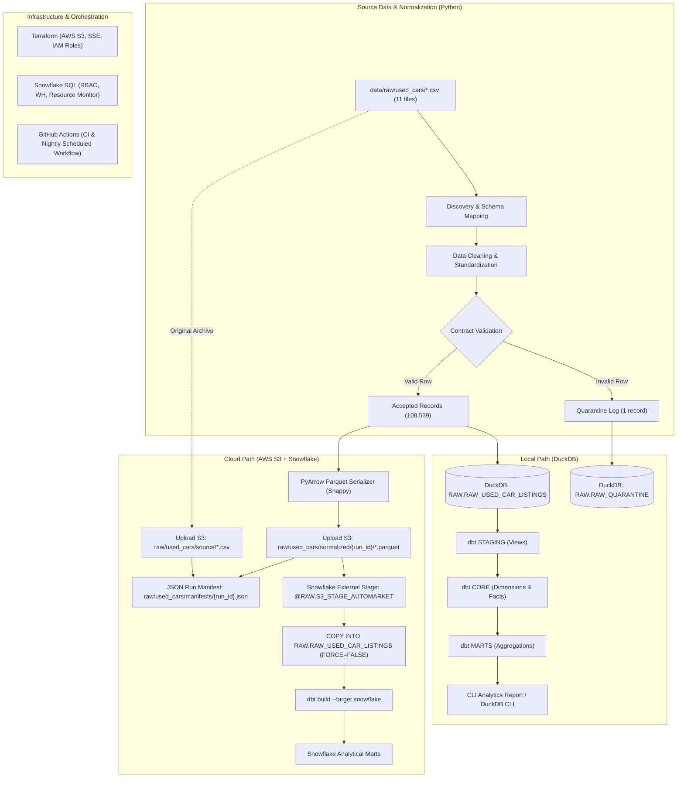

# AutoMarket Intel — Used-Car Pricing & Inventory Intelligence Platform

[](https://github.com/Rabyegh/AutoMarket-Intel/actions/workflows/ci.yml)
[](https://github.com/Rabyegh/AutoMarket-Intel/actions/workflows/nightly_snowflake.yml)
[](https://www.python.org/downloads/)
[](https://www.getdbt.com/)
[](https://duckdb.org/)
[](https://www.snowflake.com/)

A production-grade, dual-engine data engineering platform for UK used-car market analytics. AutoMarket Intel ingests raw used-car listing data, validates and standardizes it against explicit data contracts, and provides two parallel execution paths:

1. **Local Pipeline (Zero-Cost / Self-Contained):** Ingests raw CSVs, enforces schemas, normalizes data into an embedded [DuckDB](https://duckdb.org/) data warehouse, and runs [dbt](https://www.getdbt.com/) transformations to produce analytical marts locally in seconds.
2. **Cloud Pipeline (AWS S3 + Snowflake + dbt):** Serializes validated records into typed Apache Parquet files, uploads them with collision-resistant object keys and JSON run manifests to [Amazon S3](https://aws.amazon.com/s3/), loads them into [Snowflake RAW](https://www.snowflake.com/) via stage-backed `COPY INTO` operations, and transforms them into multidimensional marts using dbt on Snowflake. Orchestrated via GitHub Actions with OIDC and key-pair authentication.

---

## Table of Contents

1. [Business Problem & Analytical Scope](#1-business-problem--analytical-scope)
2. [Data Source & Provenance](#2-data-source--provenance)
3. [Architecture Overview](#3-architecture-overview)
4. [Repository Structure](#4-repository-structure)
5. [Prerequisites & Environment Setup](#5-prerequisites--environment-setup)
6. [Local Pipeline Execution](#6-local-pipeline-execution)
7. [Cloud Pipeline Execution](#7-cloud-pipeline-execution)
8. [Data Models & Schema Contracts](#8-data-models--schema-contracts)
9. [Data Quality & Quarantine Rules](#9-data-quality--quarantine-rules)
10. [Analytical Queries & Reporting](#10-analytical-queries--reporting)
11. [Market Simulation](#11-market-simulation)
12. [Infrastructure & Cloud Security](#12-infrastructure--cloud-security)
13. [Testing & Automated Verification](#13-testing--automated-verification)
14. [Operational Runbook & Troubleshooting](#14-operational-runbook--troubleshooting)

---

## 1. Business Problem & Analytical Scope

Used-car dealerships, fleet operators, and automotive analysts face extreme pricing variance driven by age, mileage, transmission, and fuel type. This platform answers core operational and pricing intelligence questions:

- **Pricing Benchmarks:** What is the median, 25th, and 75th percentile asking price for any vehicle configuration (e.g., 2018 Ford Fiesta, 1.0L Petrol Manual, 30,000–40,000 miles)?
- **Inventory Valuation & Deviations:** Which vehicles in current inventory are priced above or below market peer benchmarks, and by what percentage?
- **Fleet Composition:** What is the market distribution across fuel types (Petrol, Diesel, Hybrid, Electric) and manufacturers?
- **Data Integrity:** What proportion of listings fail data contracts or present implausible engineering attributes (e.g., year > 2025, price < £100, impossible engine sizes)?

> **Domain Distinctions:**
> - **Asking Prices vs. Transaction Prices:** All listing prices (`price_gbp`) represent advertised asking prices, not negotiated final settlement prices.
> - **Snapshot Mechanics:** The raw dataset is a cross-sectional snapshot. A listing that ceases to appear in subsequent snapshots does not prove a sale occurred (it may have expired, been unlisted, or moved).

---

## 2. Data Source & Provenance

The raw dataset comprises 11 real-world UK used-car listing CSV files (100,000+ records) sourced from Kaggle. The source files are partitioned primarily by manufacturer, with two model-specific files featuring differing column sets:

| File | Manufacturer / Model | Raw Rows | Schema Variant | Notes |
|---|---|---|---|---|
| `audi.csv` | Audi | 10,668 | Schema A (9 cols) | Complete schema |
| `bmw.csv` | BMW | 10,781 | Schema A (9 cols) | Complete schema |
| `ford.csv` | Ford | 17,965 | Schema A (9 cols) | Complete schema |
| `hyundi.csv` | Hyundai | 4,860 | Schema A (9 cols) | Typo in raw file stem preserved; normalized to `Hyundai` |
| `merc.csv` | Mercedes-Benz | 13,119 | Schema A (9 cols) | Complete schema |
| `skoda.csv` | Skoda | 6,267 | Schema A (9 cols) | Complete schema |
| `toyota.csv` | Toyota | 6,738 | Schema A (9 cols) | Complete schema |
| `vauxhall.csv` | Vauxhall | 13,632 | Schema A (9 cols) | Complete schema |
| `vw.csv` | Volkswagen | 15,157 | Schema A (9 cols) | Complete schema |
| `cclass.csv` | Mercedes-Benz C-Class | 3,899 | Schema B (7 cols) | Omits `tax` and `mpg` |
| `focus.csv` | Ford Focus | 5,454 | Schema B (7 cols) | Omits `tax` and `mpg` |
| `unclean cclass.csv` | — | 4,006 | Raw Scrape | Excluded from ingestion by discovery rules |
| `unclean focus.csv` | — | 5,604 | Raw Scrape | Excluded from ingestion by discovery rules |

**Total Ingested Records:** 108,540 raw records evaluated &rarr; **108,539 accepted**, **1 quarantined** (a listing with registration year `2060`).

---

## 3. Architecture Overview



---

## 4. Repository Structure

```
AutoMarket-Intel/
├── .github/
│   └── workflows/
│       ├── ci.yml                    # Unit + integration tests + linting on PR/push
│       └── nightly_snowflake.yml     # Scheduled/dispatch cloud pipeline (S3 + Snowflake + dbt)
├── contracts/                        # Data contracts & canonical schema specifications
│   ├── fleet_events.v1.yaml
│   ├── used_car_listings.v1.yaml     # Canonical listing schema contract
│   └── vpic_decode.v1.yaml
├── data/
│   ├── raw/used_cars/                # 11 source CSV files + 2 excluded unclean files
│   ├── warehouse.duckdb              # Embedded DuckDB database (local artifact)
│   └── run_log.jsonl                 # Ingestion execution history log
├── dbt/                              # dbt transformation project
│   ├── macros/
│   │   └── generate_schema_name.sql  # Custom schema macro (RAW, STAGING, CORE, MARTS)
│   ├── models/
│   │   ├── staging/                  # stg_used_car_listings, stg_rejected_listings
│   │   ├── core/                     # dim_vehicle, fct_listing_snapshot
│   │   └── marts/                    # mart_comparable_prices, mart_pricing_deviations, mart_inventory_summary
│   ├── dbt_project.yml               # Project configuration
│   └── profiles.yml                  # Dual targets: duckdb (default) and snowflake
├── docs/                             # Architecture and operational documentation
│   ├── ARCHITECTURE.md
│   ├── CONTRACTS.md
│   ├── DEPLOY.md                     # Step-by-step AWS and Snowflake provisioning guide
│   ├── RUNBOOK.md                    # Operational incident response and maintenance
│   └── SOURCES.md                    # Dataset provenance and license information
├── infra/
│   ├── snowflake/
│   │   └── setup.sql                 # Idempotent Snowflake DDL: roles, warehouse, schemas, stage, formats
│   └── terraform/                    # AWS Infrastructure as Code
│       ├── main.tf                   # S3 bucket, encryption, IAM roles for Snowflake & GitHub OIDC
│       ├── variables.tf
│       ├── outputs.tf
│       └── terraform.tfvars.example
├── src/automarket/                   # Core Python application package
│   ├── cli.py                        # Typer CLI entrypoint: ingest, report, simulate, upload-s3, load-snowflake
│   ├── config.py                     # Configuration validation
│   ├── logging_utils.py              # Structured console & file logging
│   ├── runlog.py                     # JSONL run tracking
│   ├── ingestion/                    # Discovery, cleaning, normalization, and validation logic
│   │   ├── discovery.py
│   │   ├── normalize.py
│   │   ├── pipeline.py
│   │   └── validation.py
│   ├── simulation/                   # Synthetic weekly snapshot generator
│   │   └── snapshots.py
│   └── storage/                      # Cloud storage & data warehouse integrations
│       ├── s3.py                     # Deterministic S3 uploads, retries, and manifests
│       ├── serializer.py             # Schema-enforced PyArrow Parquet serialization
│       └── snowflake_loader.py       # Snowflake key-pair connector, stage verification, COPY INTO
├── tests/
│   ├── conftest.py                   # Pytest fixtures and mock configurations
│   ├── integration/                  # End-to-end local pipeline tests (DuckDB)
│   └── unit/                         # Unit tests (discovery, validation, S3 keys, Moto, Snowflake)
├── .env.example                      # Template environment variables
├── Makefile                          # Standardized developer workflow targets
└── pyproject.toml                    # Build system, dependencies, Ruff, and pytest configs
```

---

## 5. Prerequisites & Environment Setup

### Prerequisites
- **Python:** Version 3.11 or higher
- **uv:** Fast Python package and project manager (`pip install uv`)
- **Git**

### Installation
Clone the repository and install dependencies using `uv`:

```bash
git clone https://github.com/Rabyegh/AutoMarket-Intel.git
cd AutoMarket-Intel

# Create and activate virtual environment
uv venv .venv
# Windows PowerShell:
.venv\Scripts\Activate.ps1
# Linux/macOS:
source .venv/bin/activate

# Install development dependencies (includes pytest, ruff, moto[s3], dbt-duckdb)
make install

# (Optional) Install cloud dependencies if interacting with AWS/Snowflake
make install-cloud
```

### Environment Configuration
Copy the sample environment file:
```bash
cp .env.example .env
```
For local DuckDB development, the defaults in `.env` work immediately with zero credentials required.

---

## 6. Local Pipeline Execution

The local pipeline requires no cloud credentials and executes in seconds using embedded DuckDB.

### Full Pipeline Run via Makefile
```bash
# 1. Run full ingestion and dbt models, then print summary report
make demo
```

### Step-by-Step Execution
```bash
# 1. Ingest raw CSVs into DuckDB (raw.raw_used_car_listings & raw.raw_quarantine)
make ingest

# 2. Build dbt models (Staging views, Core tables, Analytical Marts)
make dbt-build

# 3. Execute all dbt data quality tests
make dbt-test

# 4. View analytical console summary
make report
```

---

## 7. Cloud Pipeline Execution

The cloud pipeline transfers processed listings to Amazon S3 as Parquet and ingests them into Snowflake.

### 1. Provision Infrastructure
1. **AWS S3 & IAM (Terraform):**
   ```bash
   cd infra/terraform
   cp terraform.tfvars.example terraform.tfvars
   # Configure aws_region, s3_raw_bucket, aws_account_id, github_repo
   terraform init
   terraform plan
   terraform apply
   ```
2. **Snowflake Bootstrap:**
   Execute `infra/snowflake/setup.sql` in Snowflake with `ACCOUNTADMIN` or `SYSADMIN`.
   Complete the 3-step storage integration handshake detailed in [`docs/DEPLOY.md`](docs/DEPLOY.md).

### 2. Manual Cloud Execution
Set credentials in `.env` or your shell:
```bash
# Generate a run identifier
export RUN_ID="manual-$(date +%Y%m%d%H%M%S)"

# 1. Serialize records to Parquet and upload to S3 with manifest
uv run python -m automarket.cli upload-s3 --data-dir data/raw/used_cars --run-id "$RUN_ID"

# 2. Execute COPY INTO loading from S3 stage into Snowflake RAW
uv run python -m automarket.cli load-snowflake "$RUN_ID"

# 3. Build dbt models on Snowflake
cd dbt && uv run dbt build --target snowflake
```

Or run all three steps via Makefile:
```bash
make cloud-pipeline RUN_ID=2026-10-20-001
```

### 3. Automated Scheduled Execution
The pipeline is automated via GitHub Actions in [`.github/workflows/nightly_snowflake.yml`](.github/workflows/nightly_snowflake.yml):
- **Schedule:** Every Monday at 03:00 UTC (or manually via GitHub `workflow_dispatch`).
- **Authentication:** AWS OIDC (no stored AWS keys) and Snowflake RSA key-pair authentication.
- **Observability:** Generates run summaries and verifies row counts post-load.

---

## 8. Data Models & Schema Contracts

### Canonical Listing Schema (`contracts/used_car_listings.v1.yaml`)

Every listing is normalized into a deterministic, strictly typed schema:

| Column Name | Type | Constraints | Description |
|---|---|---|---|
| `row_id` | VARCHAR(16) | NOT NULL, PK | First 16 chars of SHA-256 hash across canonical business fields |
| `source_file` | VARCHAR(255) | NOT NULL | Originating CSV filename |
| `make` | VARCHAR(100) | NOT NULL | Standardized vehicle make |
| `model` | VARCHAR(255) | NOT NULL | Vehicle model name |
| `year` | INTEGER | NOT NULL | Registration year (1970 &le; year &le; 2025) |
| `price_gbp` | INTEGER | NOT NULL | Asking price in GBP (&ge; 100) |
| `transmission` | VARCHAR(20) | NOT NULL | Standardized: `Manual`, `Automatic`, `Semi-Auto`, `Other` |
| `mileage_miles` | INTEGER | NOT NULL | Odometer reading (&ge; 0) |
| `fuel_type` | VARCHAR(20) | NOT NULL | Standardized: `Petrol`, `Diesel`, `Hybrid`, `Electric`, `Other` |
| `tax_gbp` | INTEGER | NULLABLE | Annual road tax (NULL in Schema B files) |
| `mpg` | FLOAT | NULLABLE | Miles per gallon (NULL in Schema B files) |
| `engine_size_l` | FLOAT | NULLABLE | Engine displacement in liters (0.0 to 10.0) |

### Warehouse Architecture
- **Staging (`STAGING.stg_used_car_listings`):** View casting raw data, generating surrogate keys (`vehicle_key` from `make`, `model`, `year`, `fuel_type`, `transmission`), and computing price-per-mile ratios.
- **Core Dimensions (`CORE.dim_vehicle`):** Type-1 dimension table cataloging unique vehicle configurations and listing frequency.
- **Core Facts (`CORE.fct_listing_snapshot`):** Fact table capturing individual listing observations.
- **Analytical Marts:**
  - `MARTS.mart_comparable_prices`: Segment-level pricing aggregates (count, min, p25, median, p75, max). Flags small peer groups (`< 5` listings).
  - `MARTS.mart_pricing_deviations`: Listing-level deviation calculations comparing asking price to peer-group median asking price.
  - `MARTS.mart_inventory_summary`: High-level inventory composition by make, transmission, and fuel type.

---

## 9. Data Quality & Quarantine Rules

Data quality checks operate at two independent tiers:

1. **Ingestion Tier (Python / Pydantic):**
   Records violating business constraints are rejected prior to warehouse loading and diverted to `raw.raw_quarantine` with descriptive rejection reasons:
   - **Year Bounds:** Must fall between 1970 and 2025.
   - **Price Bounds:** Must be between £100 and £500,000.
   - **Mileage Bounds:** Must be non-negative and &le; 500,000 miles.
   - **Engine Size:** Must be &le; 10.0L.
   - **Required Fields:** Missing make, model, year, transmission, or fuel type triggers rejection.

2. **Warehouse Tier (dbt Data Tests):**
   53 automated dbt tests validate referential integrity, column ranges, uniqueness, and non-null constraints across Staging, Core, and Marts.

---

## 10. Analytical Queries & Reporting

Direct SQL examples for analyzing the DuckDB or Snowflake warehouse:

```sql
-- 1. Identify significantly underpriced listings (> 20% below peer median)
SELECT
    make,
    model,
    registration_year,
    fuel_type,
    mileage_miles,
    asking_price_gbp,
    peer_median_price_gbp,
    pct_vs_median
FROM marts.mart_pricing_deviations
WHERE NOT is_small_peer_group
  AND pct_vs_median <= -20.0
ORDER BY pct_vs_median ASC
LIMIT 10;

-- 2. Inspect peer-group pricing benchmarks for a specific model
SELECT
    model,
    registration_year,
    fuel_type,
    transmission,
    peer_group_size,
    p25_asking_price_gbp,
    median_asking_price_gbp,
    p75_asking_price_gbp
FROM marts.mart_comparable_prices
WHERE make = 'Ford' AND model = 'Fiesta' AND registration_year = 2018;

-- 3. Review quarantined records
SELECT rejection_reason, COUNT(*) AS rejected_count
FROM raw.raw_quarantine
GROUP BY rejection_reason;
```

---

## 11. Market Simulation

Because the dataset is a static snapshot lacking historical dates, the CLI includes a Monte Carlo simulation engine (`src/automarket/simulation/`) to generate realistic synthetic weekly inventory movements:

```bash
uv run python -m automarket.cli simulate --seed 42 --weeks 8 --sample-size 1000
```
- **Deterministic:** Fully reproducible given a fixed `--seed`.
- **Isolated:** All synthetic rows are flagged `is_simulated = TRUE` and stored in a separate table (`simulated_snapshots`) to prevent analytical pollution of real data.

---

## 12. Infrastructure & Cloud Security

### Security Architecture
- **Zero Hardcoded Secrets:** Credentials, keys, and tokens are read exclusively from environment variables or GitHub Secrets.
- **Key-Pair Snowflake Authentication:** Eliminates static passwords in CI/CD. The service account (`AUTOMARKET_SVC`) authenticates using an unencrypted 2048-bit RSA key pair.
- **GitHub Actions OIDC:** Uses short-lived AWS STS Web Identity tokens scoped to `repo:Rabyegh/AutoMarket-Intel:ref:refs/heads/main` to upload S3 objects without long-lived AWS IAM access keys.
- **S3 Bucket Hardening:** SSE-S3 AES-256 encryption, public access block enabled, bucket versioning enabled.
- **Least-Privilege IAM:** Snowflake reader role restricted to `s3:GetObject` on `raw/used_cars/*`.

### Cost Control Controls
- **Snowflake Resource Monitor:** Hard cap configured (`AUTOMARKET_MONITOR` with 5 monthly credits quota; suspends warehouse at 100% quota).
- **Auto-Suspend:** Virtual warehouse (`AUTOMARKET_WH`, X-Small) suspends automatically after 60 seconds of inactivity.
- **Transient Schemas:** `RAW`, `STAGING`, `CORE`, and `MARTS` are declared `TRANSIENT` to eliminate fail-safe storage fees for reproducible pipeline data.

---

## 13. Testing & Automated Verification

The test suite covers unit logic, contract parsing, data normalization, mocked S3 operations (via Moto), and mocked Snowflake loaders.

```bash
# Run full pytest suite
make test
```

### Test Suite Inventory (155 passing tests)
| Test Module | Test Focus | Status |
|---|---|---|
| `tests/unit/test_discovery.py` | CSV discovery, make inference, column mapping | 14 Passed |
| `tests/unit/test_normalize.py` | Fuel type, transmission, make/model parsing | 27 Passed |
| `tests/unit/test_validation.py` | Contract rules, boundary conditions, quarantine | 17 Passed |
| `tests/unit/test_serializer.py` | PyArrow schema types, nullable fields, magic bytes | 10 Passed |
| `tests/unit/test_s3_keys.py` | Deterministic key construction, path traversal sanitization | 11 Passed |
| `tests/unit/test_s3_upload.py` | S3 uploads, skip-existing, error handling, Moto mock | 14 Passed |
| `tests/unit/test_snowflake_loader.py` | Snowflake config, key parsing, COPY INTO, error reporting | 19 Passed |
| `tests/unit/test_simulation.py` | Random seed reproducibility, drift rules, snapshot dates | 9 Passed |
| `tests/integration/test_pipeline.py` | End-to-end DuckDB ingestion, quarantine, run log | 13 Passed |
| **Total Test Suite** | **155 Passed, 0 Skipped, 0 Failed in ~4.5s** | &check; |

### Code Quality & dbt Compilation
```bash
# Verify formatting and linting
make lint

# Validate dbt models and tests (DuckDB)
make dbt-build
# Result: PASS=60 WARN=0 ERROR=0 TOTAL=60 (6 tables, 1 view, 53 tests)
```

---

## 14. Operational Runbook & Troubleshooting

Refer to [`docs/RUNBOOK.md`](docs/RUNBOOK.md) for full operational guides. Key recovery workflows:

- **Idempotent Re-runs:**
  - S3 Upload: Passing `--skip-existing` checks object headers before uploading and skips unchanged files.
  - Snowflake Load: `COPY INTO` executes with `FORCE = FALSE`. Snowflake skips previously ingested files based on internal table load history.
  - Downstream Deduplication: Staging models deduplicate on deterministic `row_id` hashes to prevent duplicates even across new run IDs.
- **Handling Partial Loads (`ON_ERROR = CONTINUE`):**
  - The Snowflake loader parses load status per file. Any file resulting in `PARTIALLY_LOADED` or `LOAD_FAILED` appends errors to `LoadResult.errors`, sets `success = False`, and logs rejected rows for investigation.
- **Inspecting Load History in Snowflake:**
  ```sql
  SELECT * FROM TABLE(INFORMATION_SCHEMA.COPY_HISTORY(
      TABLE_NAME => 'AUTOMARKET_DB.RAW.RAW_USED_CAR_LISTINGS',
      START_TIME => DATEADD(hours, -24, CURRENT_TIMESTAMP())
  ));
  ```
